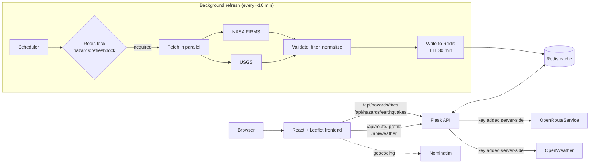

# SafeRoute

Real-time wildfire and earthquake map for Canada, with evacuation routes to the nearest safe zone.

   


SafeRoute pulls near-real-time **NASA FIRMS** satellite fire detections and **USGS** earthquake data into one interactive map. You can search for a place, filter by hazard type and magnitude, use your location, and get **evacuation routes** from a fire to nearby hospitals, emergency centres and towns through OpenRouteService.

> **Group project.** SafeRoute started as the Disaster Alert System, built by a team of four for CMPT 276 (Introduction to Software Engineering) at Simon Fraser University in Summer 2025, where it won the course's **Teaching Team Award**. This repository is my continuation of it. I added the Flask API, the Redis cache and refresh pipeline, and moved every API key to the server.

## Features

- **Live hazards.** Wildfire detections (VIIRS, high/nominal confidence) and 30 days of earthquakes, refreshed every 10 minutes.
- **Evacuation routing.** Finds candidate safe zones around a fire and ranks car and heavy-vehicle routes by distance, time and safety score.
- **Search and filters.** Place search through Nominatim (OpenStreetMap), fire/earthquake filter, minimum magnitude slider.
- **Local weather.** Temperature, wind and sunset for your location on the home page.
- **Safety guides.** Short wildfire and earthquake preparedness pages.

## Architecture



**How a request works.** The frontend only talks to the Flask API. Hazard endpoints serve data straight from Redis, so a page load never waits on NASA or USGS. Routing and weather calls go through the API too, which adds the API keys on the server. No key is ever shipped to the browser.

**How data stays fresh.** Each Flask worker runs a small background thread. Every 10 minutes it tries to take a Redis lock (`SET NX EX`). Only the worker that gets it refreshes, so running several workers doesn't multiply API calls. It fetches FIRMS and USGS in parallel, keeps only valid points inside the coverage area, and writes each dataset with a 30-minute TTL. The lock is released with an owner check, so a slow worker can't delete someone else's lock.

**What happens when a source is down.** NASA and USGS refresh independently. If one fails, its last good data stays in Redis and keeps being served. The TTL is three times the refresh interval, which gives a fallback window of about 20 minutes. If the cache is empty (first start), the API fetches the missing dataset once inline before answering.

| Key | Contents | TTL |
|---|---|---|
| `hazards:fires` | `{updated_at, count, data[]}` from NASA FIRMS | 30 min |
| `hazards:earthquakes` | `{updated_at, count, data[]}` from USGS | 30 min |
| `hazards:refresh:lock` | owner token of the worker refreshing | 2 min |
| `weather:<lat>:<lon>` | OpenWeather response, coordinates rounded to ~1 km | 10 min |

## API

| Method | Path | Description |
|---|---|---|
| `GET` | `/api/hazards/fires` | Cached wildfire detections |
| `GET` | `/api/hazards/earthquakes` | Cached earthquakes |
| `POST` | `/api/route/driving-car` · `/api/route/driving-hgv` | OpenRouteService directions proxy. Body: `{"coordinates": [[lng, lat], [lng, lat]]}` |
| `GET` | `/api/weather?lat=..&lon=..` | Current weather, cached per location |
| `GET` | `/api/health` | Cache status and when each dataset was last updated |

## Tech stack

**Frontend:** React 19, TypeScript, Vite, Leaflet, react-leaflet, Leaflet.markercluster, React Router
**Backend:** Python, Flask, Gunicorn, Redis (Upstash in production), Requests
**Data:** NASA FIRMS, USGS Earthquake Hazards, OpenRouteService, Nominatim, OpenWeather
**Testing:** pytest

## Run it locally

You need Python 3.11+ and Node 20+. Redis is optional locally: without `REDIS_URL` the API uses an in-memory cache.

```bash
# 1. Backend
cd backend
python3 -m venv .venv && source .venv/bin/activate
pip install -r requirements-dev.txt
cp .env.example .env        # add your API keys
python app.py               # http://127.0.0.1:5050

# 2. Frontend (new terminal)
cd frontend
npm ci
npm run dev                 # http://localhost:5173, /api is proxied to Flask
```

Free API keys: [NASA FIRMS map key](https://firms.modaps.eosdis.nasa.gov/api/map_key/) · [OpenRouteService](https://openrouteservice.org/dev/#/signup) · [OpenWeather](https://home.openweathermap.org/api_keys) · [Upstash Redis](https://upstash.com/)

### Tests

```bash
cd backend && python -m pytest
```

The tests cover cold-start fills, serving from cache, keeping old data when a source fails, the refresh lock, input validation, and parsing of FIRMS and USGS data.

## Deploy

`render.yaml` sets up a single Render web service. Flask serves both the API and the built React app, so there's no CORS to configure. Set `FIRMS_MAP_KEY`, `ORS_API_KEY`, `OPENWEATHER_API_KEY` and `REDIS_URL` in the Render dashboard.

## License

[MIT](LICENSE)
