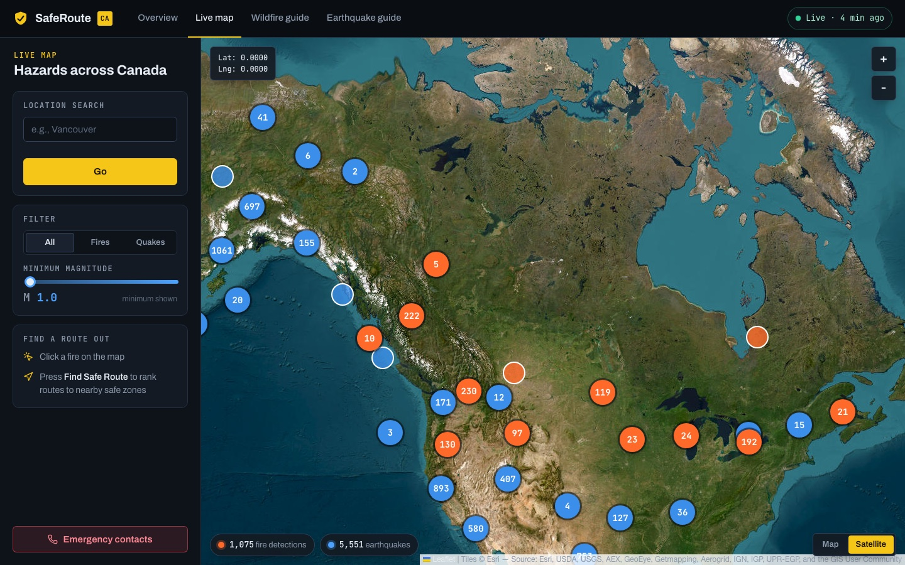
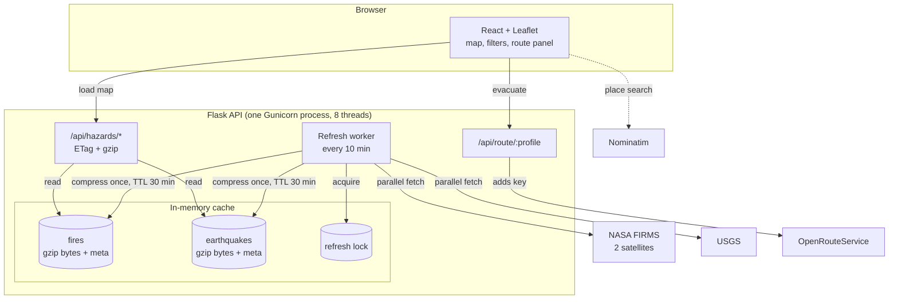

<div align="center">

# 🛡️ SafeRoute

**See active wildfires and earthquakes across Canada, then find the fastest way out.**

[How it works](#how-it-works) · [Benchmarks](#benchmarks) · [Run it locally](#run-it-locally)



</div>

---

## Why SafeRoute

During wildfire season the information people need is spread across a lot of places: satellite fire data in one, earthquake feeds in another, and a regular maps app that knows nothing about either. SafeRoute brings it together. You open one map and see what's burning or shaking near you. Click a fire, and it finds nearby hospitals, emergency centres and towns and ranks driving routes to them.

## What you can do

| | |
|---|---|
| 🔥 **Track wildfires** | Satellite heat detections from two NASA VIIRS satellites, kept to high and nominal confidence, clustered so a whole province stays readable |
| 🌎 **Track earthquakes** | 30 days of USGS events with magnitude, depth, tsunami flag and a link to the official report |
| 🧭 **Plan an evacuation** | Pick a fire and get up to three ranked routes (car and heavy vehicle) to safe zones, with distance, drive time and a safety score |
| 🔎 **Search and filter** | Jump to any place, show fires or earthquakes only, set a minimum magnitude, or centre on your own location |
| 📊 **Check the overview** | A status board with live fire and earthquake counts, the strongest recent quake, and the most intense fire detections |
| 📘 **Read the guides** | Wildfire and earthquake preparedness guides, plus one-tap BC emergency contacts |

<details>
<summary><b>Overview page</b></summary>
<br>

</details>

## How it works

The browser never talks to NASA, USGS or OpenRouteService directly. Everything goes through a small Flask API that keeps hazard data in memory and holds the API keys. There are no databases or extra services to run.



**Loading the map**
1. The page calls `/api/hazards/fires` and `/api/hazards/earthquakes`.
2. Flask sends the gzip-compressed bytes it already holds, unchanged, with `Content-Encoding: gzip`. The 2 MB earthquake set travels as 307 KB.
3. Every response carries an `ETag` tied to when the data was last refreshed. A browser coming back within the same refresh window sends `If-None-Match` and gets an empty `304 Not Modified`.
4. If the cache is empty (first boot, or the server waking from sleep), the request fetches that dataset itself. If the background refresh is already fetching, it waits for that one instead of calling NASA a second time.

**Keeping data fresh**
1. A background thread wakes every 10 minutes and takes the refresh lock, so it never overlaps with a cold-start fetch.
2. It fetches both FIRMS satellites and USGS at the same time.
3. Points are checked and filtered: valid coordinates, inside the coverage area, nominal or high confidence for fires.
4. Each dataset is gzip-compressed once and stored with a 30-minute TTL, along with a small metadata entry (update time and count) for the ETag and the health check.

**Planning a route**
1. The frontend finds candidate safe zones near the fire through Nominatim.
2. It sends route requests to `/api/route/driving-car` and `/api/route/driving-hgv`.
3. Flask checks the request, adds the OpenRouteService key, and forwards it. The key never reaches the browser.

## Design decisions

| Decision | Why |
|---|---|
| **In-memory cache, no Redis** | The whole dataset is about 330 KB compressed, so memory is plenty. No database to host, pay for or keep in sync, and reading from memory beat Redis in the benchmarks below. |
| **One process, many threads** | Every request shares one cache and one refresher, so NASA is called once per cycle no matter how many visitors there are. Requests are I/O-bound, so threads handle concurrency well. |
| **Refresh lock** | The background refresh and a cold-start request never fetch the same data at once. A request that arrives mid-refresh waits for it. |
| **TTL 3× the refresh interval** | If a source goes down, its last good data keeps being served for about 20 minutes instead of disappearing. |
| Sources refresh **independently** | A USGS outage doesn't block fire updates, and the reverse is true too. |
| **Store hazards gzipped, serve bytes as-is** | Compressed once per refresh instead of per request. Responses are about 7× smaller, and there's no JSON work on the hot path. |
| **ETags** | Repeat visits within the same refresh window cost a 304 with no body instead of re-downloading 325 KB. |
| **Proxy** routing through Flask | API keys stay server-side, and the endpoint only accepts the two routing profiles the app uses. |
| One service for **API + frontend** | Flask serves the built React app, so there's no CORS setup and one deploy. |

## Benchmarks

Measured on October 30, 2026 on a MacBook (Apple Silicon) with live NASA and USGS APIs. Endpoint figures are from 200 warm requests each, and refresh figures are medians of 5 runs. Each row shows one change and what it did.

**Serving the map data**

| `GET /api/hazards/earthquakes` (~7,700 events) | p50 | p95 | Sent to browser |
|---|---:|---:|---:|
| JSON decoded and re-encoded on every request | 31.2 ms | 32.7 ms | 1,997 KB |
| Same data in Redis 7.4, sent as-is | 16.7 ms | 41.6 ms | 1,997 KB |
| Gzipped in Redis, sent as-is | 5.2 ms | 8.8 ms | 307 KB |
| **Gzipped in memory, sent as-is (current)** | **3.2 ms** | **3.8 ms** | **307 KB** |
| **Repeat visit, `If-None-Match` → 304** | **0.7 ms** | | **0 KB** |

Fires (~1,000 detections) went from 171 KB to **18 KB** per response, with a p50 of **0.9 ms**, or 0.7 ms and 0 KB on a repeat visit.

I first built this with Redis, then measured it. For a dataset this small, served by one process, an in-memory cache was faster and simpler, so Redis was removed. If SafeRoute ever needed several servers behind a load balancer, a shared cache would earn its place again. The refresh lock and TTLs already follow the same pattern, so the swap would be small.

**Refreshing from NASA and USGS**

| | Time |
|---|---:|
| FIRMS satellites fetched one after another, then USGS | 1.27 s |
| **Both satellites and USGS fetched in parallel** | **0.58 s** |

The parallel refresh takes as long as its slowest request (one FIRMS satellite), so adding more sources wouldn't make it slower. A cold start (first boot or waking from sleep) answers its first request in about 0.7 s.

Reproduce with the server running:

```bash
cd backend && python scripts/benchmark.py --requests 200 --runs 5
```

## Run it locally

**You need:** Python 3.11+, Node 20+, a free [NASA FIRMS map key](https://firms.modaps.eosdis.nasa.gov/api/map_key/) and a free [OpenRouteService key](https://openrouteservice.org/dev/#/signup). Nothing else to install or host.

```bash
git clone https://github.com/Jap-Sidhu/safe-route.git
cd safe-route

# API
cd backend
python3 -m venv .venv && source .venv/bin/activate
pip install -r requirements-dev.txt
cp .env.example .env            # paste your keys
python app.py                   # http://127.0.0.1:5050

# Frontend, in a second terminal
cd frontend
npm ci && npm run dev           # http://localhost:5173, /api proxied to Flask
```

### Configuration

| Variable | Required | Default | Purpose |
|---|:---:|---|---|
| `FIRMS_MAP_KEY` | ✅ | | NASA FIRMS access |
| `ORS_API_KEY` | ✅ | | OpenRouteService routing |
| `REFRESH_INTERVAL_SECONDS` | | `600` | How often the worker refreshes |
| `CACHE_TTL_SECONDS` | | `1800` | How long cached data lives |
| `FIRMS_DAYS` | | `2` | Days of fire detections (1–10) |
| `FIRMS_MIN_FRP` | | `0` | Minimum fire radiative power in MW |
| `USGS_DAYS` | | `30` | Days of earthquakes |

## API reference

| Endpoint | Returns |
|---|---|
| `GET /api/hazards/fires` | `{updated_at, count, data: [{lat, lng, properties}]}` |
| `GET /api/hazards/earthquakes` | Same shape, with magnitude, depth, place, time |
| `POST /api/route/{driving-car\|driving-hgv}` | OpenRouteService GeoJSON. Body: `{"coordinates": [[lng, lat], [lng, lat]]}` |
| `GET /api/health` | Last update time and count per dataset |

Hazard responses include an `ETag`. Send it back as `If-None-Match` to get a `304` when nothing changed. `503` means no usable data is cached yet, and `400` means the request was invalid.

## Project layout

```
safe-route/
├── backend/
│   ├── app.py            Flask app: hazard endpoints, routing proxy, serves the built frontend
│   ├── refresher.py      Background worker: lock → parallel fetch → write with TTL
│   ├── sources.py        NASA FIRMS + USGS clients and data normalization
│   ├── cache.py          Thread-safe in-memory cache: gzip payloads, metadata, TTLs
│   ├── config.py         Settings from environment variables
│   ├── scripts/benchmark.py
│   └── tests/test_api.py
├── frontend/
│   ├── public/safezone.js   Safe-zone search and route ranking
│   └── src/
│       ├── api.ts           API client
│       ├── hooks/           Live status polling (/api/health)
│       └── Components/      Layout (top bar, footer), Homepage, Map, SafetyGuide
├── docs/
├── render.yaml           Render deployment (single web service)
└── LICENSE
```

## Testing

```bash
cd backend && python -m pytest
```

16 tests cover the cold-start fill, waiting for a refresh already in progress, serving from cache without refetching, gzip storage and the uncompressed fallback, ETag / 304 handling, the health check, keeping old data when a source fails, the refresh lock (busy and released), input validation on the routing proxy, and parsing FIRMS CSV and USGS GeoJSON.

## Deploy

`render.yaml` defines one Render web service that installs both halves, builds the React app, and starts Gunicorn. Add `FIRMS_MAP_KEY` and `ORS_API_KEY` in the Render dashboard. That's the only setup.

## Know the limits

- **A heat detection is not a fire perimeter.** FIRMS detects heat from orbit. That includes things like gas flares and controlled burns, and the satellites pass over a few times a day, so detections can be hours old.
- **Routes are suggestions.** They come from road data, not live closures or the fire's actual spread.
- **This is not an alert system.** Always follow official evacuation orders, [Alert Ready](https://www.alertready.ca/) and local authorities. In an emergency, call 911.

## Credits

SafeRoute grew out of the **Disaster Alert System**, a group project for CMPT 276 (Introduction to Software Engineering) at Simon Fraser University in Summer 2025. Our team won the course's **Teaching Team Award** for innovation, teamwork and user-centred design.

In this version I rebuilt the backend: the Flask API, the caching and refresh pipeline, the routing proxy that keeps keys off the client, parallel data fetching, the benchmarks and the tests. I also fixed several bugs that kept the original from building or routing.

**Data:** [NASA FIRMS](https://firms.modaps.eosdis.nasa.gov/) · [USGS Earthquake Hazards Program](https://earthquake.usgs.gov/) · [OpenRouteService](https://openrouteservice.org/) · [OpenStreetMap / Nominatim](https://nominatim.org/)

**Built by** [Japdeep Sidhu](https://github.com/Jap-Sidhu) · [LinkedIn](https://www.linkedin.com/in/japdeep-sidhu-07708023a/) · [jap-s.dev](https://www.jap-s.dev)

Released under the [MIT License](LICENSE).
