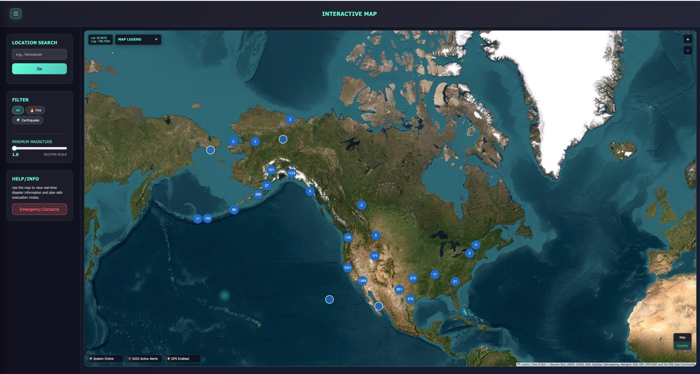
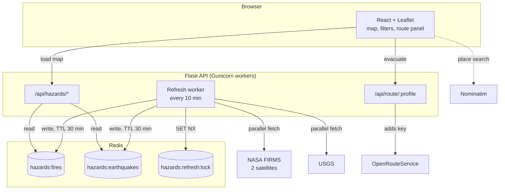

<div align="center">

# 🛡️ SafeRoute

**See active wildfires and earthquakes across Canada, then find the fastest way out.**

[How it works](#how-it-works) · [Benchmarks](#benchmarks) · [Run it locally](#run-it-locally)



</div>

---

## Why SafeRoute

During wildfire season the information people need is spread across a lot of places: satellite fire data in one, earthquake feeds in another, and a regular maps app that knows nothing about either. SafeRoute brings it together. You open one map and see what's burning or shaking near you. Click a fire, and it finds nearby hospitals, emergency centres and towns and ranks driving routes to them.

## What you can do

| | |
|---|---|
| 🔥 **Track wildfires** | Satellite heat detections from two NASA VIIRS satellites, kept to high and nominal confidence, clustered so a whole province stays readable |
| 🌎 **Track earthquakes** | 30 days of USGS events with magnitude, depth, tsunami flag and a link to the official report |
| 🧭 **Plan an evacuation** | Pick a fire and get up to three ranked routes (car and heavy vehicle) to safe zones, with distance, drive time and a safety score |
| 🔎 **Search and filter** | Jump to any place, show fires or earthquakes only, set a minimum magnitude, or centre on your own location |
| 📘 **Read the guides** | Short wildfire and earthquake preparedness pages plus emergency contacts |

## How it works

The browser never talks to NASA, USGS or OpenRouteService directly. Everything goes through a small Flask API that keeps hazard data in Redis and holds the API keys.



**Loading the map**
1. The page calls `/api/hazards/fires` and `/api/hazards/earthquakes`.
2. Flask reads the gzip-compressed JSON from Redis and sends those bytes back unchanged with `Content-Encoding: gzip`. The 2 MB earthquake set travels as 307 KB, and the median response is about 5 ms.
3. Only if Redis is empty (a brand-new deploy) does Flask fetch that one dataset before answering.

**Keeping data fresh**
1. Every 10 minutes, each worker tries to claim `hazards:refresh:lock` with `SET NX EX`. One wins, and the others skip this round.
2. The winner fetches both FIRMS satellites and USGS at the same time.
3. Points are checked and filtered: valid coordinates, inside the coverage area, nominal or high confidence for fires.
4. Each dataset is gzip-compressed once and written with a 30-minute TTL. The lock is released with an owner check (a small Lua script).

**Planning a route**
1. The frontend finds candidate safe zones near the fire through Nominatim.
2. It sends route requests to `/api/route/driving-car` and `/api/route/driving-hgv`.
3. Flask checks the request, adds the OpenRouteService key, and forwards it. The key never reaches the browser.

## Design decisions

| Decision | Why |
|---|---|
| Cache in **Redis**, not in each process | Every Gunicorn worker serves the same data, and a restart doesn't mean a cold start. |
| **Lock** before refreshing | With several workers, only one calls NASA and USGS per cycle. This saves API quota and avoids rate limits. |
| **TTL 3× the refresh interval** | If a source goes down, its last good data keeps being served for about 20 minutes instead of disappearing. |
| Sources refresh **independently** | A USGS outage doesn't block fire updates, and the reverse is true too. |
| **Store hazards gzipped, serve bytes as-is** | Compressed once per refresh instead of per request. Responses and Redis memory are about 7× smaller, and there's no JSON decoding on the hot path. |
| **Proxy** routing through Flask | API keys stay server-side, and the endpoint only accepts the two routing profiles the app uses. |
| One service for **API + frontend** | Flask serves the built React app, so there's no CORS setup and one deploy. |

## Benchmarks

Measured on October 30, 2026 on a MacBook (Apple Silicon): 2 Gunicorn workers, **Redis 7.4 in Docker**, live NASA and USGS APIs. Endpoint figures are from 200 warm requests each. Refresh figures are medians of 5 runs. Each row shows one optimization and what it changed.

**Serving the map data**

| `GET /api/hazards/earthquakes` (~7,700 events) | p50 | p95 | Sent to browser |
|---|---:|---:|---:|
| Plain JSON in Redis, decoded and re-encoded per request | 31 ms¹ | 33 ms¹ | 1,997 KB |
| Plain JSON in Redis, sent as-is | 16.7 ms | 41.6 ms | 1,997 KB |
| **Gzipped in Redis, sent as-is with `Content-Encoding: gzip`** | **5.2 ms** | **8.8 ms** | **307 KB** |

The fires endpoint (~1,000 detections) went from 171 KB to **18 KB** per request, with a p50 of **1.8 ms**. Compressing once in the refresh worker, instead of on every request, also shrinks Redis memory by about 7×.

¹ measured with the in-process cache. Decoding and re-encoding dominated, and Redis would only add to it.

**Refreshing from NASA and USGS**

| | Time |
|---|---:|
| FIRMS satellites fetched one after another, then USGS | 1.27 s |
| **Both satellites and USGS fetched in parallel** | **0.58 s** |

The parallel refresh takes as long as its slowest request (one FIRMS satellite), so adding more sources wouldn't make it slower.

Reproduce with the server running:

```bash
cd backend && python scripts/benchmark.py --requests 200 --runs 5
```

> A hosted Redis such as Upstash adds a network round trip (typically a few ms in the same region). Gzip helps even more there, since 7× less data crosses that network.

## Run it locally

**You need:** Python 3.11+, Node 20+, a free [NASA FIRMS map key](https://firms.modaps.eosdis.nasa.gov/api/map_key/) and a free [OpenRouteService key](https://openrouteservice.org/dev/#/signup). Redis is optional locally.

```bash
git clone https://github.com/Jap-Sidhu/safe-route.git
cd safe-route

# API
cd backend
python3 -m venv .venv && source .venv/bin/activate
pip install -r requirements-dev.txt
cp .env.example .env            # paste your keys
python app.py                   # http://127.0.0.1:5050

# Frontend, in a second terminal
cd frontend
npm ci && npm run dev           # http://localhost:5173, /api proxied to Flask
```

Want real Redis locally? `docker run -d -p 6379:6379 redis:7`, then set `REDIS_URL=redis://127.0.0.1:6379/0`.

### Configuration

| Variable | Required | Default | Purpose |
|---|:---:|---|---|
| `FIRMS_MAP_KEY` | ✅ | | NASA FIRMS access |
| `ORS_API_KEY` | ✅ | | OpenRouteService routing |
| `REDIS_URL` | prod | in-memory | `redis://` or `rediss://` (Upstash) |
| `REFRESH_INTERVAL_SECONDS` | | `600` | How often the worker refreshes |
| `CACHE_TTL_SECONDS` | | `1800` | How long cached data lives |
| `FIRMS_DAYS` | | `2` | Days of fire detections (1–10) |
| `FIRMS_MIN_FRP` | | `0` | Minimum fire radiative power in MW |
| `USGS_DAYS` | | `30` | Days of earthquakes |

## API reference

| Endpoint | Returns |
|---|---|
| `GET /api/hazards/fires` | `{updated_at, count, data: [{lat, lng, properties}]}` |
| `GET /api/hazards/earthquakes` | Same shape, with magnitude, depth, place, time |
| `POST /api/route/{driving-car\|driving-hgv}` | OpenRouteService GeoJSON. Body: `{"coordinates": [[lng, lat], [lng, lat]]}` |
| `GET /api/health` | Cache backend, whether it's reachable, last update and count per dataset |

`503` means no usable data is cached yet. `400` means the request was invalid.

## Project layout

```
safe-route/
├── backend/
│   ├── app.py            Flask app: hazard endpoints, routing proxy, serves the built frontend
│   ├── refresher.py      Background worker: lock → parallel fetch → write with TTL
│   ├── sources.py        NASA FIRMS + USGS clients and data normalization
│   ├── cache.py          Redis client, with an in-memory fallback for local dev
│   ├── config.py         Settings from environment variables
│   ├── scripts/benchmark.py
│   └── tests/test_api.py
├── frontend/
│   ├── public/safezone.js   Safe-zone search and route ranking
│   └── src/
│       ├── api.ts           API client
│       └── Components/      Map, Search, Filter, Contacts, Homepage, SafetyGuide…
├── docs/
├── render.yaml           Render deployment (single web service)
└── LICENSE
```

## Testing

```bash
cd backend && python -m pytest
```

12 tests cover the cold-start fill, serving from cache without refetching, gzip storage and the uncompressed fallback, keeping old data when a source fails, the refresh lock (busy and released), input validation on the routing proxy, and parsing FIRMS CSV and USGS GeoJSON.

## Deploy

`render.yaml` defines one Render web service that installs both halves, builds the React app, and starts Gunicorn. Add `FIRMS_MAP_KEY`, `ORS_API_KEY` and `REDIS_URL` (a free [Upstash](https://upstash.com/) database works) in the Render dashboard.

## Know the limits

- **A heat detection is not a fire perimeter.** FIRMS detects heat from orbit. That includes things like gas flares and controlled burns, and the satellites pass over a few times a day, so detections can be hours old.
- **Routes are suggestions.** They come from road data, not live closures or the fire's actual spread.
- **This is not an alert system.** Always follow official evacuation orders, [Alert Ready](https://www.alertready.ca/) and local authorities. In an emergency, call 911.

## Credits

SafeRoute grew out of the **Disaster Alert System**, a group project for CMPT 276 (Introduction to Software Engineering) at Simon Fraser University in Summer 2025. Our team won the course's **Teaching Team Award** for innovation, teamwork and user-centred design.

In this version I rebuilt the backend: the Flask API, Redis caching and refresh pipeline, the routing proxy that keeps keys off the client, parallel data fetching, the benchmarks and the tests. I also fixed several bugs that kept the original from building or routing.

**Data:** [NASA FIRMS](https://firms.modaps.eosdis.nasa.gov/) · [USGS Earthquake Hazards Program](https://earthquake.usgs.gov/) · [OpenRouteService](https://openrouteservice.org/) · [OpenStreetMap / Nominatim](https://nominatim.org/)

**Built by** [Japdeep Sidhu](https://github.com/Jap-Sidhu) · [LinkedIn](https://www.linkedin.com/in/japdeep-sidhu-07708023a/) · [jap-s.dev](https://www.jap-s.dev)

Released under the [MIT License](LICENSE).
